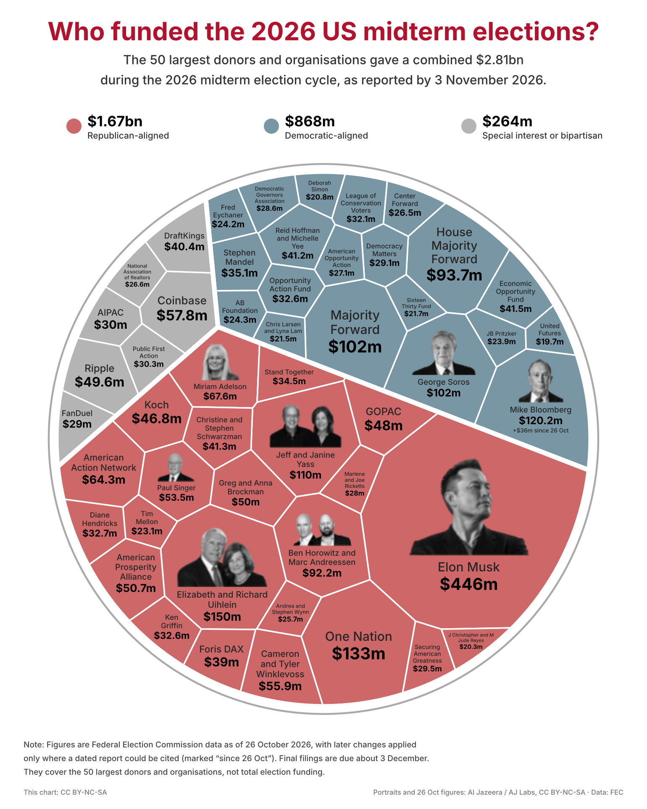

# Who funded the 2026 US midterm elections?

A rebuild of Al Jazeera's top-50 donor graphic as data plus code, updated to election day (3 November 2026).



## Run it

```
pip install -r requirements.txt
python crop_faces.py        # portraits  -> assets/faces/
python make_chart.py        # chart      -> out/midterm_donors_<date>.png
python docs/make_primer.py  # SciPy primer -> docs/scipy_primer.pdf
python -m pytest tests      # checks on the layout code
```

| File | What it is |
| --- | --- |
| `data/donors_2026-10-26.csv` | The catalog: all 50 names, groups and amounts read off the source graphic |
| `data/updates_2026-11-03.csv` | Changes after 26 Oct that could be cited, with source and caveats |
| `data/final_2026-12-03.csv` | Empty. Fill it when final filings exist and rerun `make_chart.py` |
| `voronoi_treemap.py` | The layout: convex cells with exact areas |
| `make_chart.py` | Loads data, lays out, fits labels and portraits, draws |
| `crop_faces.py` | Cuts the eight portraits out of the source graphic |
| `docs/scipy_primer.pdf` | Two-page introduction to the parts of SciPy used here |

New to SciPy? Read [`docs/scipy_primer.pdf`](docs/scipy_primer.pdf) first; the section on the algorithm below assumes it.

## The data, and how far to trust it

**Baseline.** The 50 rows were transcribed by hand from Al Jazeera / AJ Labs, "Who is funding the 2026 US midterm elections?" (FEC data as of 26 October 2026). `make_chart.py` checks the transcription: the three group sums come to 1,674.7, 831.8 and 263.7 ($m), which round to the $1.67bn, $832m and $264m printed on the graphic, and the total is 2,770.2 against the printed $2.77bn.

**Election-day update.** No one had published a per-donor list as of 3 November when this was built (11 November), so the chart is the baseline plus changes that could be cited. There is one:

| Donor | 26 Oct | 3 Nov | Basis |
| --- | --- | --- | --- |
| Mike Bloomberg | $84.2m | $120.2m | Al Jazeera (1 Nov) reports "an additional $36m added on Friday"; Politico, as summarised by Yahoo and Newsmax (30 Oct), itemises it |

That lifts the Democratic-aligned total to $867.8m and the overall total to $2.81bn.

**What limits this.**

- These sources were read as search-result excerpts only. The article pages, the FEC API and OpenSecrets were all blocked from the build environment, so nothing here was checked against a primary record.
- Part of Bloomberg's $36m may not be in FEC federal data at all ($12m to Everytown, plus state governor races, per the itemisation). It is included because Al Jazeera, whose counting the baseline follows, adds it to his total.
- Other donors very likely gave more after 26 October. Absence of a cited change is not evidence of no change. The FEC's filing system was also reported offline for about 41 hours in late October (CNBC, 28 Oct), delaying the 24- and 48-hour reports that would show late money.
- Membership of the top 50 is frozen at 26 October. A donor who entered the top 50 afterwards is missing.
- Outlets count differently. The Brennan Center has Andreessen and Horowitz at $115m where Al Jazeera has $92.2m. A figure replaces the baseline only when it follows Al Jazeera's counting.

**3 December.** FEC post-general reports are due about then. Put the final rows in `data/final_2026-12-03.csv` (same columns; a blank amount removes a donor, a new name adds one) and rerun. The title date, totals, layout and footnote all follow from the data.

## Images and licence

The portraits are crops of the source graphic, which is marked CC BY-NC-SA. So this chart is non-commercial, credits Al Jazeera / AJ Labs at the bottom right, and is shared under the same licence. The portraits themselves may be agency photographs that Al Jazeera's licence does not cover; check before using the chart anywhere that matters.

A sharper source was looked for and not found: `aljazeera.com`, Wikimedia and the web archive were all unreachable from the build environment. The crops therefore come from a 770 px wide upload and are 37 to 92 px tall, drawn at up to 1.3 times that size. They are soft. With a larger copy of the graphic in `assets/source/`, only the boxes in `crop_faces.py` need rescaling.

## The layout algorithm

The chart is a Voronoi treemap: a disc cut into convex cells, one per donor, each cell's area proportional to the money. This section says what the code does, in order, and proves that it is right. Function names refer to `voronoi_treemap.py`.

### Setting

- $`\Omega`$: a convex polygon (the disc, as a 180-sided polygon), with area $`|\Omega|`$.
- $`s_1,\dots,s_n`$: distinct points, the *sites*. One per cell.
- $`w_1,\dots,w_n`$: real numbers, the *weights*. These are what we solve for.
- $`a_1,\dots,a_n > 0`$: target areas, scaled so that $`\sum_i a_i = |\Omega|`$.

The *power distance* from a point $`x`$ to site $`i`$ is

```math
\pi_i(x) = \lVert x - s_i\rVert^2 - w_i ,
```

and cell $`i`$ is the part of $`\Omega`$ where site $`i`$ has the smallest power distance:

```math
C_i(w) = \{\, x \in \Omega : \pi_i(x) \le \pi_j(x) \ \text{for all } j \,\}, \qquad A_i(w) = \operatorname{area}\, C_i(w).
```

With all weights equal this is the ordinary Voronoi diagram. **Goal:** find $`w`$ with $`A_i(w) = a_i`$ for every $`i`$.

### Step 1. Cells are polygons cut by straight lines (`power_cells`)

**Lemma 1.** $`\pi_i(x) \le \pi_j(x)`$ if and only if

```math
2\,(s_j - s_i)\cdot x \;\le\; \lVert s_j\rVert^2 - \lVert s_i\rVert^2 + w_i - w_j .
```

*Proof.* Expand both squares. $`\lVert x\rVert^2`$ appears on both sides and cancels; collect what is left. $`\blacksquare`$

Since $`s_i \ne s_j`$, this is a half-plane $`H_{ij}`$. So

```math
C_i = \Omega \cap \bigcap_{j \ne i} H_{ij} .
```

**Proposition 1 (convex).** Every cell is convex. *Proof.* It is an intersection of convex sets. $`\blacksquare`$

**Proposition 2 (tiling).** The cells cover $`\Omega`$ and overlap only on their edges, so $`\sum_i A_i(w) = |\Omega|`$ for every $`w`$.
*Proof.* Cover: at any $`x`$ the smallest of the finitely many $`\pi_i(x)`$ is attained by some $`i`$, so $`x \in C_i`$. Overlap: if $`x \in C_i \cap C_j`$ then $`\pi_i(x) = \pi_j(x)`$, which by Lemma 1 puts $`x`$ on the boundary line of $`H_{ij}`$. A line has zero area. $`\blacksquare`$

### Step 2. Cutting a polygon with a half-plane (`clip_halfplane`)

Write the half-plane as $`g(x) \le 0`$ with $`g(x) = n\cdot x - c`$. Walk the polygon's edges once: keep each vertex with $`g \le 0`$, and on each edge whose endpoints have different signs add the point

```math
p_k + t\,(p_{k+1} - p_k), \qquad t = \frac{g(p_k)}{g(p_k) - g(p_{k+1})} .
```

**Proposition 3 (exact).** For a convex polygon $`P`$ the output is exactly $`P \cap H`$.
*Proof.* $`P \cap H`$ is a convex polygon whose corners are of two kinds: corners of $`P`$ that lie in $`H`$, and points where the boundary of $`P`$ crosses the line $`g = 0`$. Because $`g`$ is linear along an edge, an edge crosses the line exactly when its endpoints have different signs, and then exactly once, at the $`t`$ above (solve $`g = 0`$ along the edge). The walk emits precisely these points, in boundary order. $`\blacksquare`$

Applying Proposition 3 once per other site, Lemma 1 gives that `power_cells` returns $`C_i`$ exactly, up to floating-point rounding. Each clip keeps the polygon convex, so the next clip is valid.

### Step 3. Measuring cells (`polygon_area`, `polygon_centroid`, `second_moment`)

For a counter-clockwise polygon with vertices $`p_k = (x_k, y_k)`$ and $`\times_k = x_k y_{k+1} - x_{k+1} y_k`$, the shoelace formulas give

```math
A = \tfrac12 \sum_k \times_k , \qquad \bar{x} = \frac{1}{6A}\sum_k (p_k + p_{k+1})\,\times_k .
```

Step 4 also needs $`\int_P \lVert x - s\rVert^2\,dx`$. Shift so $`s`$ is the origin and split $`P`$ into triangles $`(0, p, q)`$ over consecutive vertices, each with signed area $`T`$. Writing $`x = u\,p + v\,q`$ with $`u, v \ge 0,\ u + v \le 1`$ gives $`dx = 2T\,du\,dv`$, and with $`\iint u^2 = \iint v^2 = \tfrac1{12}`$, $`\iint uv = \tfrac1{24}`$:

```math
\int_{(0,p,q)} \lVert x\rVert^2\,dx = \frac{T}{6}\left(\lVert p\rVert^2 + \lVert q\rVert^2 + p\cdot q\right).
```

Signed areas make the sum correct even when $`s`$ is outside $`P`$.

### Step 4. Finding the weights (`objective`, `solve_weights`)

Define

```math
F(w) \;=\; \int_\Omega \min_i \pi_i(x)\,dx \;+\; \sum_i w_i a_i
\;=\; \sum_i \int_{C_i(w)} \left(\lVert x - s_i\rVert^2 - w_i\right) dx \;+\; \sum_i w_i a_i .
```

The second form is what `objective` computes, using Step 3.

**Theorem.** Assume $`\sum_i a_i = |\Omega|`$. Then:

1. $`F`$ is concave.
2. $`\dfrac{\partial F}{\partial w_i} = a_i - A_i(w)`$.
3. $`F`$ has a maximiser, and $`w`$ is a maximiser if and only if $`A_i(w) = a_i`$ for all $`i`$.

So weights with exactly the target areas always exist, for any distinct sites, and they are found by maximising $`F`$.

*Proof of 1.* Fix $`x`$. Each $`\pi_i(x) = \lVert x - s_i\rVert^2 - w_i`$ is a linear function of $`w`$ plus a constant. A minimum of such functions is concave, an integral of concave functions is concave, and adding the linear term $`\sum w_i a_i`$ keeps it concave. $`\blacksquare`$

*Proof of 2.* Let $`m(x, w) = \min_i \pi_i(x)`$. For every $`x`$ off the cell edges (all but a set of zero area, by Proposition 2) the minimum is attained by one index only, so near that $`w`$ we have $`m = \pi_k`$ for the cell $`k`$ containing $`x`$, and $`\partial m/\partial w_i`$ is $`-1`$ if $`x \in C_i`$ and $`0`$ otherwise. Also $`|m(x,w) - m(x,w')| \le \max_i |w_i - w'_i|`$, so difference quotients are bounded by 1 and we may differentiate under the integral (dominated convergence):

```math
\frac{\partial}{\partial w_i}\int_\Omega m(x,w)\,dx = -\int_\Omega \mathbf{1}[x \in C_i(w)]\,dx = -A_i(w).
```

Adding the derivative $`a_i`$ of the linear term gives the claim. $`\blacksquare`$

*Proof of 3.* *Characterisation.* A differentiable concave function is maximal exactly where its gradient is zero, and by part 2 the gradient is zero exactly when $`A_i = a_i`$ for all $`i`$.

*Existence.* Adding a constant $`c`$ to every weight changes $`F`$ by $`c\,(\sum_i a_i - |\Omega|) = 0`$, so we may restrict to $`\sum_i w_i = 0`$. Let $`D = \max_{x \in \Omega,\, i} \lVert x - s_i\rVert^2`$. Then $`\min_i \pi_i(x) \le D - \max_j w_j`$, and using $`|\Omega| = \sum_i a_i`$,

```math
F(w) \;\le\; D\,|\Omega| - \sum_i a_i \left(\max_j w_j - w_i\right) \;\le\; D\,|\Omega| - a_{\min}\left(\max_j w_j - \min_j w_j\right) \;\le\; D\,|\Omega| - a_{\min}\,\lVert w\rVert_\infty .
```

The last step uses $`\sum w_i = 0`$, which forces $`\max_j w_j \ge 0 \ge \min_j w_j`$. So $`F \to -\infty`$ as $`\lVert w\rVert \to \infty`$ on that subspace; $`F`$ is continuous; hence it attains a maximum. $`\blacksquare`$

Two remarks.

- **The assumption is necessary, and its failure is silent.** If $`\sum a_i \ne |\Omega|`$ then $`F(w + c\mathbf{1}) = F(w) + c(\sum a_i - |\Omega|)`$ is unbounded and no solution exists (Proposition 2 already says areas must sum to $`|\Omega|`$). The optimiser does not complain; it sends the weights to $`10^{23}`$. This happened while building the primer, and `solve_weights` now rejects such input.
- **Uniqueness (sketch).** The solution is unique up to adding one constant to all weights. If $`w`$ and $`w'`$ both solve it and $`w' - w`$ is not constant, let $`K`$ be the indices where $`w'_i - w_i`$ is largest. For $`i \in K`$ every half-plane $`H_{ij}`$ stays the same or grows, and it grows strictly for $`j \notin K`$. Since $`\Omega`$ is connected, some cell in $`K`$ shares an edge of positive length with a cell outside $`K`$; that edge moves outward, so the cells of $`K`$ gain area in total. That contradicts both solutions having the same areas.

This existence result is due to Aurenhammer, Hoffmann and Aronov (1998); the proof above is a self-contained version of the variational argument.

**What the optimiser adds, and what it does not.** `scipy.optimize.minimize` (method L-BFGS-B) minimises $`-F`$ using the gradient $`A(w) - a`$. Two facts make this safe:

- Because $`F`$ is concave there are no false summits. Any point where the optimiser's gradient test passes is the solution.
- The gradient *is* the area error. The optimiser's stopping test and the quantity we care about are the same thing.

What is not proved here: that L-BFGS-B must reach that point in finitely many steps. Standard convergence theorems for it assume more smoothness than $`F`$ has ($`F`$ is once continuously differentiable, with kinks in its second derivative where cells appear or vanish). So the code does not rely on it. After every solve it measures the worst relative area error and raises if it exceeds $`0.1\%`$. On the donor data the measured error is below $`10^{-6}`$.

### Step 5. Making cells rounder (`voronoi_treemap`)

Any distinct sites give correct areas, but random sites give slivers. So: solve the weights, move each site to the centroid of its cell, solve again, and repeat 40 times (Lloyd's method). This step has no proof and needs none. It changes what the cells look like; the last thing done is always a weight solve, so areas are exact whatever the sites are.

### Step 6. Two levels (`make_chart.py`)

The disc is first split into three cells for the three groups, then each group's cell is split among its donors.

**Proposition 4.** The second level is valid. *Proof.* By Propositions 1 and 3 each group cell is a convex polygon, which is all that Steps 1 to 5 assume of $`\Omega`$. $`\blacksquare`$

A donor's area is then (group share of disc) times (donor share of group), which is the donor's share of the total.

### What the tests check

| Claim | Test |
| --- | --- |
| Areas match targets, cells tile, cells convex (Props 1, 2, Theorem 3) | 10 random skewed weight sets |
| Gradient formula (Theorem 2) | `scipy.optimize.check_grad` against finite differences |
| `power_cells` is right (Lemma 1, Prop 3) | Equal weights reproduce `scipy.spatial.Voronoi` corner for corner |
| Second-moment formula (Step 3) | Unit square about its corner equals 2/3 |
| Infeasible targets are refused | Targets summing to 0.8 of the area raise an error |
| Same seed, same picture | Two runs compared exactly |

### Limits

- The proofs are about real numbers. The code uses floating point and stops at a tolerance, which is why it measures its own error.
- The layout depends on the seed (`SEED` in `make_chart.py`). Areas are right for every seed; which cells are neighbours is not meaningful, and does not match Al Jazeera's arrangement.
- The disc is a 180-sided polygon, 0.02% smaller than the true disc. Cell areas are exact shares of the polygon.
- Label fitting is a search over font sizes and positions, not an optimisation. If a label cannot fit, the script stops and asks for another seed.

## Sources

Read during this build, as search-result excerpts (pages themselves were unreachable):

- Al Jazeera, [Tracking the money: The biggest donors in the 2026 US midterm elections](https://www.aljazeera.com/news/2026/10/27/tracking-the-money-the-biggest-donors-in-the-2026-us-midterm-elections), 27 Oct 2026. Source of the graphic.
- Al Jazeera, [Where are the most expensive midterm races and who is funding them?](https://www.aljazeera.com/economy/2026/11/1/where-are-the-most-expensive-midterm-races-and-who-is-funding-them), 1 Nov 2026.
- Yahoo / Newsmax, [Report: Bloomberg Spending $36 Million More to Boost Dems](https://www.newsmax.com/politics/michael-bloomberg-james-talarico-adam-hamilton/2026/10/30/id/1274618/), 30 Oct 2026, summarising Politico.
- CNBC, [FEC campaign finance system offline days before midterms](https://www.cnbc.com/2026/10/28/fec-hack-outage-campaign-finance-filings.html), 28 Oct 2026.
- Brennan Center, [Big Money Breaks Records, Boosts GOP](https://www.brennancenter.org/our-work/analysis-opinion/big-money-breaks-records-boosts-gop-5-things-know-about-midterms).
- F. Aurenhammer, F. Hoffmann, B. Aronov, "Minkowski-Type Theorems and Least-Squares Clustering", *Algorithmica* 20, 61-76 (1998), [doi:10.1007/PL00009187](https://link.springer.com/doi/10.1007/pl00009187). Abstract and a secondary statement of the theorem were read, not the full paper.

Recalled from memory, not checked during this build:

- Shoelace formulas for polygon area and centroid; Sutherland and Hodgman's polygon clipping (1974); Lloyd's method (1982).
- Voronoi treemaps as a chart form: Balzer and Deussen (2005); Nocaj and Brandes, "Computing Voronoi Treemaps" (2012). This code does not follow their weight-update rule; it solves for the weights directly as in Step 4.
